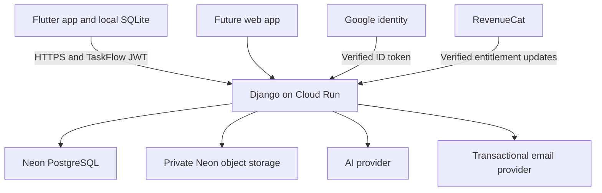

# TaskFlow backend architecture and rollout

Decision date: 9 October 2026. The target architecture deploys TaskFlow's existing Django API to Google Cloud Run, with Neon PostgreSQL for persistent application data and private Neon object storage for attachments. Flutter remains offline capable. The future web app should use the same authenticated API. The marketing website remains a separate service. The Django API has not yet been deployed to Cloud Run.

## System boundaries

Cloud Run executes Python and application permissions. PostgreSQL stores accounts, external identities, sessions, tasks, lists, file metadata, quota reservations, and billing entitlement state. Object storage holds file bytes. Google establishes identity; Django issues the existing TaskFlow access and rotating refresh tokens. Google login must retain the same user and RevenueCat billing identity when explicitly linked to an existing account.

Only the API receives database credentials, storage credentials, and AI secrets. Flutter receives public OAuth client IDs and its own short-lived application tokens. Production secrets belong in Secret Manager, outside source control and container layers. Existing prototype credentials must be reviewed and rotated before production use.

Development AI routing (11 October 2026): local Django uses AI Studio Gemma 4
26B for free-first extraction, with Gemini 3.1 Flash-Lite on Vertex as a bounded
paid fallback for quota/temporary failures. Audio has an independent route.
Staging runs on Vertex only (`AI_ROUTE=vertex`, decided 2026-11-04).
LangChain core composes the validated extraction pipeline; it has no autonomous
tools or write access. The dedicated `taskflow-ai-staging` identity can predict
and use APIs only. Local impersonated ADC is ignored and mounted read-only;
Cloud Run should use its own attached runtime identity. This does not move the
Django API, database or files to Cloud Run yet. See the [backend guide](../README.md)
for free-only/direct-Vertex modes, retry limits and repeatable setup.

## Environments and deployment

**Staging implementation, 11 October:** the API is now deployed as
`taskflow-api-staging` on Cloud Run, backed by an isolated schema-only Neon
branch and private object storage. Shared counters use atomic PostgreSQL locks,
email uses the Resend outbox plus Cloud Tasks, and migrations run in their own
job. See [staging configuration and validation](STAGING.md). The bullets below
also describe requirements for the future production deployment.

- Existing Neon project: `square-butterfly-45392108`, AWS Frankfurt, PostgreSQL 18. Its `production` branch already has the private `docs4taskflow` bucket.
- Use an isolated development branch with synthetic data first. Branching can copy account and file visibility: do not casually copy real production data into developer environments.
- Keep infrastructure configuration, deployment scripts and operational documentation under `Backend`; Flutter stays under `App`.
- Proposed API service: `taskflow-api`, Cloud Run Frankfurt (`europe-west3`), request-based billing, minimum zero instances, initially maximum two. Size CPU, memory, concurrency and database pool from measured load. Google and Neon remain different cloud providers even in Frankfurt.
- Use pooled TLS PostgreSQL connections for requests and a direct connection for migrations. Validate Django transaction-pooling settings and avoid server-side cursors across transactions.
- Run migrations once in a controlled deployment job. Do not seed demonstration accounts or migrate on every container start. Listen on Cloud Run's `PORT`.
- Containers are disposable: no persistent local media volume, local database, local quota counters, or in-process background scheduler in production.
- Adapt Django's storage backend to the S3-compatible private bucket. Preserve authorization and quotas on every upload/download. Initially proxy bounded uploads through Django; evaluate short-lived authorized download URLs later.
- Replace Redis-dependent durable quota/login counters with explicit atomic PostgreSQL transactions before deployment, or deliberately provision a shared Redis service. Django's local-memory cache is unsuitable for cross-instance protection; its generic database cache alone is not an atomic quota ledger.
- Split liveness from dependency checks. The current `/api/health/` executes `SELECT 1`; polling it frequently can prevent database suspension. Monitor real request errors and use infrequent dependency probes.
- Configure production recovery email, trusted proxy handling, allowed hosts, HTTPS and a verified sender. The marketing URL is not currently a deployed Django API URL.

## Availability and cost policy

Use Neon Free for development; move the production organization to Launch with a valid payment method before public launch. Do not rely on a last-minute manual upgrade during a user spike. Paid capacity still has operational limits, payment dependencies and outages; it cannot guarantee unlimited availability.

Google Cloud currently displays a trial account. The owner must also activate its full billing account before the trial expires or credits run out, preserving applicable free allowances. A paid Neon organization alone does not address that separate availability risk. No billing plan was upgraded during this implementation.

Pricing checked 9 October 2026 from [Neon pricing](https://neon.com/pricing):

| Launch meter | USD rate |
| --- | --- |
| Database compute | $0.106 per CU-hour |
| PostgreSQL storage | $0.35 per GB-month |
| Object storage | $0.023 per GB-month |
| Public egress | 500 GB per project included, then $0.10 per GB |

Launch has no monthly minimum and charges usage; an upgrade is not simply free allowances plus overage. The plan applies to the organization. Restore history, snapshots, other services and taxes can add charges. Free has 1 GB of database storage and 5 GB of file storage per project; exhausted compute/egress can suspend service and database storage limits can block writes.

Illustrative Launch subtotal: 100 CU-hours + 1 GB database + 100 GB files = $10.60 + $0.35 + $2.30 = $13.25/month, before history, snapshots, egress overage, tax, Cloud Run, email and AI. This is an assumed workload, not a forecast or a total hosting quote. At 0.25 CU continuously for a 730-hour month, compute alone is about $19.35. Keep scale-to-zero enabled and avoid unnecessary polling.

Cloud Run free allowances are shared across the billing account, including the marketing service. Cross-cloud transfer, build artifacts, logs, email and AI must be included in the operating budget. [Cloud Run pricing](https://cloud.google.com/run/pricing).

Set alerts for cost, database/file growth, connections, API failures and payment problems. Maintain headroom and review limits before promotions. Ordinary billing alerts do not impose a hard cap. Protect expensive optional operations with explicit per-account quotas, bounded AI reservations, upload rate limits and feature-specific emergency controls. A storage or AI limit must not deliberately disable login, task editing, synchronization or existing-file access.

## Proposed customer storage and retention policy

These are proposals, not enabled product promises or deletion jobs. Current code has a 6 MiB per-file limit and 1,000 files per account for everyone. Without Pro, an account or list owner has a 100 MiB total allowance (`FREE_ATTACHMENT_MB`); Pro has no total allowance.

| Policy | Free proposal | Pro proposal |
| --- | --- | --- |
| Individual file | 6 MiB | 25 MiB |
| Total cloud attachments | 100 MiB (enforced) | No total cap (enforced) |
| Task text and completed history | Retain by default, subject to abuse controls | Retain by default, subject to abuse controls |
| Completed-task cloud attachments | Eligible for cleanup 30 days after completion | Retain within quota; offer optional 90-day cleanup |

Prefer preserving task text and deleting only old cloud attachments. Do not unexpectedly erase paying users' files after 90 days. If automatic cleanup becomes policy, obtain a clear product decision, publish it before uploads, notify users in advance (for example seven days), allow export and a grace/recovery period, and display the exact deletion date. Do not infer completion age from last modification or due date; record `completed_at` and eligibility explicitly. Reopening cancels eligibility. Active tasks, unscheduled tasks, notes, recurring series with future occurrences, shared-list access and owner changes need separate rules.

Personal quota is measured and enforced server-side; storage for a shared list is charged to its owner. Count pending uploads with atomic reservations, verify actual object size, and reconcile failures/orphan objects. Derive Pro from verified server-side RevenueCat state, never a client-supplied flag. RevenueCat is asked only when an addition would go above the free allowance; if it can't be reached, the answer is HTTP 503, never "full". On downgrade, existing content is preserved and downloads and deletion keep working; additions above the free allowance are refused straight away. Whether to add a communicated grace period first is the owner's decision.

Cleanup should be an idempotent scheduled job, not a web-process timer. Mark deletions transactionally, retain synchronization tombstones long enough for offline clients, retry physical blob deletion, and prevent an old offline device from silently restoring deleted cloud files. Distinguish cloud deletion from local device copies in the UI. Measure recovery-window storage too: soft deletion alone does not free physical bytes. Backup expiry and actual object purge must be specified and verified.

At the free allowance, 1,000 fully used Free accounts represent roughly 105 GB of object bytes. Pro has no total allowance, so a Pro account is bounded only by 1,000 files of up to 6 MiB each (about 6.3 GB); 1,000 such accounts would hold about 6.3 TB. Storage, download traffic, API load and AI together determine sustainable pricing. Do not promise unlimited uploads.

## Ordered delivery checklist

- [x] Record architecture, production availability strategy and storage proposal.
- [x] Implement Google token verification, account creation, explicit identity linking and Flutter login UI.
- [x] Configure Google OAuth branding in testing mode, Web audience client, Android debug package/signing certificate and the approved test account.
- [x] Pass backend/PostgreSQL security tests and Flutter checks; install the configured Android build on a dedicated local emulator.
- [ ] Register the iOS client and release signing certificates before testing those builds.
- [ ] Complete real Google login on a device against the intended backend; verify recovery and existing-account linking.
- [ ] Owner reviews Neon Launch scope and completes billing/payment method before public rollout.
- [ ] Owner activates full Google Cloud billing before trial credit/term expiry.
- [x] Make the staging container stateless, configure secrets/email/proxy settings, separate health checks and deploy migrations safely.
- [x] Connect an isolated Neon staging branch; verify PostgreSQL compatibility and private attachment storage.
- [x] Replace staging shared-limit dependencies and run concurrent quota/auth tests.
- [x] Verify RevenueCat entitlements server-side and enforce the free storage allowance; Pro has no total allowance.
- [ ] Approve and publish retention policy; implement warnings, export, tombstones, cleanup and restore tests before enabling deletion.
- [ ] Exercise login, offline sync, file access isolation, wake-up latency, load spikes, provider failure, backup and restore.
- [ ] Enable production billing, monitoring and release configuration; deploy the tested API and then configure Flutter's production API URL.

Full Neon remains an option for new Node.js services, but it is not needed to host our existing Django API. [Neon Functions runtime](https://neon.com/blog/neon-functions-backend-logic-next-to-your-data).
